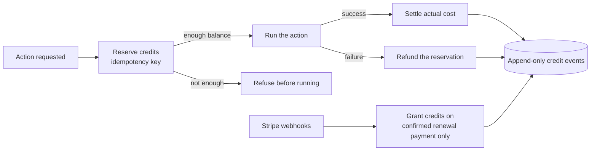

# Usage-based billing and a credit ledger

**Role:** owner, from the first Stripe integration to the live launch and beyond
**Stack:** Stripe (Checkout, Subscriptions, Subscription Schedules, PaymentIntents, webhooks), PostgreSQL functions, Next.js route handlers, Temporal, Vitest

## The problem

Every action in the product costs credits: each AI call, each tool run, each workflow step. Customers buy credits through subscription plans and top-ups. That makes billing a correctness problem, not just a payments problem. A charge that is lost, doubled or grantable for free is money lost directly.

The work had three parts:

1. Take real payments through Stripe, whose webhooks can arrive duplicated, late or out of order.
2. Charge credits for concurrent, retried and long-running work without races.
3. Make every charge explainable to the customer.

## The design

- **Reserve, settle, refund.** Credits are reserved atomically before work starts, settled at the real cost afterwards, and refunded if the work fails. Each step runs in a single database function under an idempotency key, so a retried request becomes the same charge, not a new one.
- **Two pools.** Subscription credits are spent before top-up credits, so a customer never loses paid top-ups to an expiring plan.
- **An append-only event layer** sits above the physical ledger. Every charge records who caused it, from which surface and for which record, and refunds link back to their charge. That powers a searchable usage log with CSV export.
- **Plan changes follow one rule:** adding commitment is instant, reducing it waits for the period end. Upgrades charge the price difference at once and grant the credit difference. Downgrades, annual-to-monthly switches and cancellations are scheduled through Stripe Subscription Schedules. The rule removed whole classes of abuse, such as switching billing intervals to farm credits.
- **Auto top-up has hard guardrails:** off-session charges under a lock, a threshold and a reload amount, an optional monthly limit and a rolling 24-hour cap. A declined card is never retried, and three consecutive failures switch it off and notify the customer.

## The hardest bug: double charges that looked like safe failures

Some charges were recorded as having failed safely: the reservation step had errored, so we let the action run and reconciled later. The reconciliation queue suggested this was rare. I measured the ledger directly instead, and found that about 3% of reservations failed this way, in bursts around provider slowdowns.

Most of them were not failures at all. The database had committed the reservation, but the response was lost on the way back. The later reconciliation then charged again. I traced and confirmed that for nearly every case in the sample.

The fix was to make the retry reuse the original reservation's idempotency key, so it lands on the same charge. In review I also reverted a tempting "refund on replay" change of my own, because it could have created credits out of nothing.

## Result

- Billing went live and has run in production since.
- Every charge is traceable to an actor, a surface and a record, with refunds linked to their charges.
- Free-credit loopholes found in an internal billing audit were closed, each with a test that fails without the fix.
- A live integration suite of 26 tests against Stripe and the database covers idempotency, credit grants and refunds.

## What I'd point out in an interview

- Measure the ledger, not the queue: the queue under-reported the problem many times over.
- When designing for money, a lost response is as dangerous as an error.
- A clear product rule ("adding is instant, reducing waits") can remove more bugs than more code.
