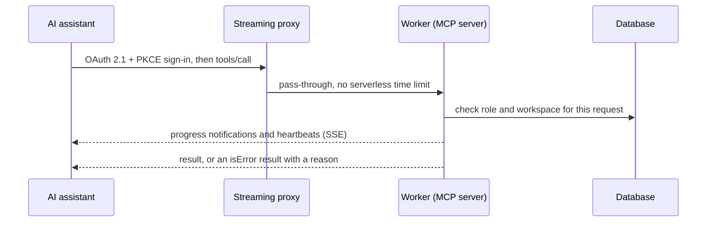

# An MCP server for AI assistants

**Role:** built and hardened the server, its OAuth flow and its tool surface
**Stack:** Model Context Protocol (JSON-RPC over Streamable HTTP and SSE), OAuth 2.1 with PKCE, Node.js, Hono, Next.js, PostgreSQL, Railway, Vitest

## The problem

The Model Context Protocol (MCP) is an open standard that lets AI assistants such as Claude call a product's tools. The goal was to let a user connect their assistant to the product, then search records, enrich lists, run workflows and read billing, all from a chat with the assistant. The server was being prepared for listing in AI-client connector directories, which brings strict rules on authentication, tool annotations and error formats.

The first version had four problems:

- Long tool calls were cut off.
- Sessions died every hour and after every deploy.
- Users were asked to re-consent every few hours.
- What the server advertised did not always match what it could actually run.

## The design

- **A streaming proxy** in front of the worker removes the serverless function's time limit, so long calls finish. The worker sends heartbeats and progress notifications while it works.
- **Sessions outlive deploys.** After a restart, a session is rebuilt from the user's bearer token, but only when that session id is genuinely absent. Sessions are keyed by client and user rather than by token, so the hourly token refresh no longer ends them.
- **OAuth 2.1 with PKCE:** dynamic client registration, consent pages, refresh-token rotation with reuse detection, revocation, and discovery metadata. Refresh rotation is atomic. Consent is skipped when a live grant already covers the request, and a "connected apps" view lets a user revoke a whole client.
- **Protocol-version negotiation.** The spec changed during the project. I deliberately stayed on the older handshake, which the assistants people actually used still required, while negotiating versions correctly on both sides.

## Making the tool surface honest

Assistants decide what to call from the schemas a server advertises, so the advertised surface must match the one that runs:

- Every tool's real per-workspace schema comes from one shared resolver, so the listing and the execution path cannot drift.
- Tool failures return as `isError` results the model can read and act on, not as generic internal errors.
- Every first-party tool (370+) was classified and annotated as read-only or destructive. A generated coverage tracker and guard tests keep it that way, and tools that cannot run outside the product are excluded.

## The hardest bug: discoverable but not callable

Tools found through search could not be called. My first fix notified the assistant that the tool list had changed, which is correct per the protocol. It still failed against a real client, because assistants snapshot the tool list once per turn and don't re-read it mid-conversation. I changed the call path to accept a discovered tool directly. Lesson: reproduce against the real client, not just the spec.

## Result

- Sessions survive deploys and token refresh, and users are no longer asked to re-consent.
- Long-running calls complete, and each failure is logged with a class that says which layer failed.
- Quotes and receipts include nested tool calls and AI-model usage, so customers are charged for the real work.
- The server, documentation and a resettable reviewer test workspace were made ready for directory review.
