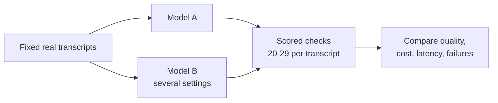

# Evaluating LLMs before switching models

**Role:** designed the evaluation, ran it, and migrated production
**Stack:** Anthropic API (structured output, effort settings, prompt caching), TypeScript, Temporal, PostgreSQL

## The problem

Every recorded meeting went through several LLM passes: analysis, action items, key moments and classification. The action-item loop ran on the most expensive model, and nobody knew what a single call cost in model spend. Swapping in a cheaper model blindly was risky: a worse model in this loop means wrong or duplicate records in a customer's data.

## The approach

1. **Measure cost first.** I tied each provider request to the meeting it served by reusing the identifier the credit charge already carried, then exposed per-call cost beside the credit charged in a read-only view. No new table was needed.
2. **Build a read-only harness.** It replays fixed real transcripts through each candidate model and effort setting, and scores the outputs with 20 to 29 checks per transcript, anchored on real record identities rather than wording. Runs are repeated, because one run is luck, not evidence.
3. **Look for silent failures, not just scores.** The comparison surfaced two problems that would have hit production:
   - The cheaper model sometimes returned its list of actions as a JSON string instead of structured data. That run silently produced zero actions, in 4 of 18 runs.
   - Forced tool choice errored in one configuration.

   I fixed both, then moved output to a forced tool call, so the API enforces the schema instead of us parsing free text.
4. **Switch one pass at a time,** with its own model setting, because the shared setting had about ten other callers.

## Result

- The smaller model matched the larger one on 28 of 29 checks at about **53% lower cost**. One lower-effort setting was rejected because it created duplicate records.
- Prompt caching then cut cost by about **another 40%**.
- Analysis and key moments moved to the same model, and classification to an even smaller one. Analysis time dropped from about 50 seconds to 16.
- The same cost data helped diagnose a production outage: AI features had stopped because a provider key was revoked. Grouping cost events by account and HTTP status found it.

## What I'd point out in an interview

- Evaluate on real inputs with checks tied to real outcomes, and repeat the runs.
- A cheaper model's failure mode matters more than its average score. Silent drops are worse than errors.
- Enforce structure through the API (tool calls), not with a parser that tries to repair text.
