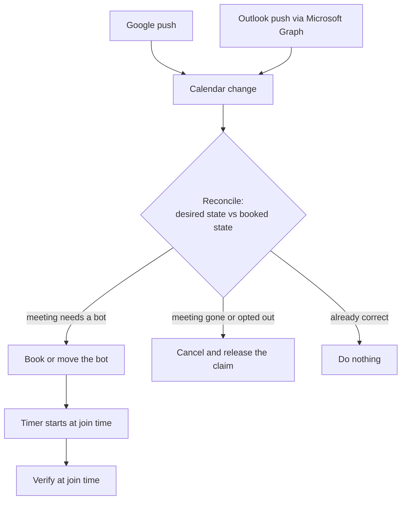

# An AI meeting notetaker

**Role:** owned most of the module, from calendar discovery to the post-call UI
**Stack:** Next.js and React, Temporal, PostgreSQL (with pg_cron), Recall.ai meeting bots, Google Calendar push, Microsoft Graph change notifications, Nango, Claude models, Supabase Storage and Realtime

## The problem

The product joins a customer's meetings with a bot: it records, transcribes and summarises them, extracts action items and key moments, and writes the results into the customer's records. Two failures are especially damaging here:

- **A missed meeting,** which the customer notices.
- **Two bots in one meeting,** which their prospect notices.

Calendars change constantly: reschedules, cancellations, a meeting on two people's calendars, duplicate and late webhooks. The first design forwarded calendar events to the recording provider and reacted to each one, and it produced duplicate bots.

## The design: converge, don't react

- **One reconcile function.** Every calendar change, whatever its source, ends in the same comparison: what should be booked versus what is booked, then book, move, cancel or do nothing. Running it twice is harmless, so duplicate and out-of-order events stop mattering.
- **Claim first.** A meeting is claimed under a key based on its normalised meeting link before any bot is booked. One meeting on two calendars becomes one row and one bot. Cancellations release the claim, so the meeting can be re-booked.
- **Push instead of polling.** Outlook went from a 30-second poll to Microsoft Graph push notifications, with subscription renewal and reconciliation. Google moved to push only. Sync frequency is tiered by need, which also cut integration cost.

## Webhook races

The recording provider's webhooks could arrive late and downgrade a call that had already been processed. A recorded call was sometimes marked Missed because another notetaker stayed in the meeting. The fixes:

- Status writes became atomic compare-and-set updates.
- When the handler can't read the current state, it returns 503 so the provider redelivers, instead of guessing.
- A rule that a call with a real transcript is never a no-show.
- A missed status with a scheduled reaper, and a Rejoin path.
- Recording archival moved into a detached background workflow that keeps retrying, and the per-file limit went from 500 MB to 2 GB.

## Reliable AI output

The action-item generator sometimes produced invalid JSON, and a single stray brace silently returned zero actions. I moved the output into a forced tool call so the schema is enforced by the API. The UI can now tell "generating" from "empty" through a status column streamed over Realtime. Approving an action is guarded against duplicates, and against overwriting a value that changed since the proposal was made.

## Result

- One meeting gets one bot, and cancellations and series changes release bookings correctly.
- Hundreds of orphaned timer workflows from the old design were cleaned up.
- Malformed AI output was eliminated at the source rather than patched afterwards.
- Users also got a YouTube-style recording player, speaker timelines, scoped and expiring share links, and assistant tools to find and prepare for meetings.
