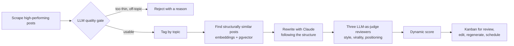

# An AI content-automation pipeline

**Role:** built it from scratch, almost entirely alone, in about two weeks, then deployed it
**Stack:** Node.js and Express, Prisma, PostgreSQL with pgvector, BullMQ and Redis workers, React and Tailwind, Claude, OpenAI embeddings, Apify, Docker, Railway

## The problem

The team wanted a steady stream of strong LinkedIn posts in its own voice. The idea was to find posts that already perform well, learn their structure, and write original posts that follow the same pattern with different content. Before this, I had built a smaller LinkedIn analytics dashboard with scheduled scraping, which became the starting point.

## The pipeline

- **Quality gate first.** An LLM decides whether a post has enough substance to repurpose before any expensive step runs, and records why it rejected the post.
- **Structure matching.** Posts are embedded and stored in PostgreSQL with pgvector. The rewrite step gets similar posts and a matched template as references, so it follows a proven structure rather than inventing one.
- **LLM-as-judge.** Three separate reviewer prompts score each draft from 0 to 10 for style, virality and positioning, and a configurable formula combines them.
- **Operations built in.** Prompt versioning lets a change be compared and rolled back, and every run logs each prompt and response pair. You can regenerate a single draft or stop a running job. Prompt caching reduced input cost.
- **Queue-based workers.** Scraping and generation run as BullMQ jobs on Redis, so the API stays responsive and jobs can be retried or stopped.

## Deployment

The backend and worker are Dockerised as separate services and deployed on Railway against a hosted PostgreSQL. I wrote the deployment guide covering per-service Dockerfiles, environment variables, ports and automatic migrations. Getting the Docker build right in a monorepo, with shared root dependencies and the right Node version, took a few iterations.

## Result

- A working end-to-end system: from scraped post to scored, editable draft in about two minutes per post.
- A React UI with a feed, a kanban board, analytics charts and a calendar view.
- The team's later automation work built on it.

## What I'd point out in an interview

- Put the cheap filter before the expensive model.
- An LLM-as-judge needs separate, narrow criteria to be useful; one "is this good?" score isn't enough.
- Logging every prompt and response pair made prompt changes debuggable instead of guesswork.
