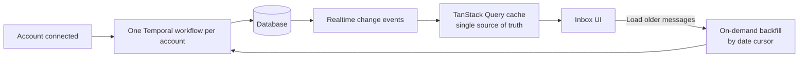

# One data path for a messaging inbox

**Role:** frontend data architecture, the sync pipeline and integrations
**Stack:** React, TanStack Query, Supabase Realtime, Temporal, Next.js API routes, Microsoft Graph, Sentry

## The problem

The product's inbox brings a team's email and LinkedIn messages into one place, synced from a third-party messaging API. It had grown several competing data-loading paths behind feature flags, and sync was unreliable:

- Users saw only 13 of their LinkedIn conversations.
- On-demand sync didn't refresh the screen.
- A stopped sync restarted itself.
- Sync state leaked between workspaces.

## What I changed

- **One data path.** TanStack Query on top of the database became the single source of truth for inbox lists. Two feature flags and a legacy hook were removed, about 1,300 lines (roughly a quarter of the module).
- **One sync workflow per account** on Temporal, with deterministic ids, so initial sync, reconnect and forced sync can't run twice. Deleting an account ends its workflow.
- **Backfill on demand.** "Load older messages" pulls history by a date cursor instead of a deep automatic sync. The 13-conversation bug came from a 30-second timeout on that deep sync.
- **One realtime subscription hook,** reference-counted, with exponential-backoff reconnection. Sync state is scoped by workspace, and a guard makes a stopped sync stay stopped.
- **Push for calendars.** Outlook meeting discovery moved from polling to Microsoft Graph change notifications, with the validation handshake, recurring-event expansion, and subscription renewal and reconciliation.

## Result

- Users see their full history, the screen refreshes after a sync, and nothing leaks between workspaces.
- Each follow-up race (restart after stop, stale state after a workspace switch, a double-send) got its own guard and test.
- Provider errors are routed through one classifier, so users read a plain explanation instead of a raw error.

## What I'd point out in an interview

- Deleting competing paths fixed more bugs than adding to them.
- "Only 13 conversations" looked like a data bug; it was a timeout. Find the mechanism before the fix.
